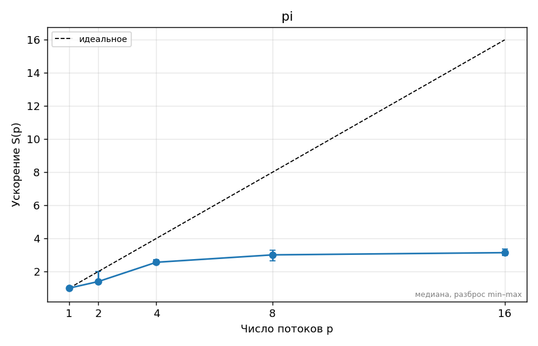

<!-- template:unfilled  ← удалите эту строку, когда отчёт готов к сдаче (иначе CI его не проверяет) -->
# ДЗ 0. Название задания — Ерзакова Ирина, вариант 5

## 1. Прогноз
1. ускорение на 2 потоках ≈ 1,8, потому что задача хорошо распараллелится и блоки не будут блокировать друг друга
   ускорение на 4 потоках (число физ. ядер) ≈ 3,6, потому что каждый поток будет выполнятся отдельно на своем физ. ядре  
   ускорение на 8 потоках (число лог. ядер) ≈ 4.1, потому что Hyper-Threading делит ресурсы одного физ. ядра между двумя логическими потоками, что снижает эффективность каждого потока

2. при запуске 16 потоков (вдвое больше логических процессоров) ускорение ≈ 3.5, потому что процессору придется постоянно останавливать потоки и чередовать их.

3. наличие E-ядер = 0 (их нет на моем процессоре i5-1135G7), поэтому на графике ускорения не возникнет резких изломов или падения эффективности при задействовании всей матрицы процессора.
<!-- Заполните и ЗАКОММИТЬТЕ этот раздел ДО запуска замеров (отдельным коммитом «Прогноз»).
     Неверный прогноз не штрафуется; штрафуется отсутствие объяснения расхождения в разделе 5.
     Отвечайте числами: «ускорение на 4 потоках ≈ 3,2, потому что …», «schedule(static) проиграет
     dynamic в ≈1,5 раза, потому что …». -->

## 2. Стенд

<!-- Ссылка на ../SYSTEM.md и то, что важно именно для этого ДЗ: число физических ядер,
     P/E-ядра, объём L3, питание от сети, режим производительности, версия компилятора и флаги. -->

## 3. Методика

<!-- Какие программы и с какими параметрами запускались, сколько повторов, как получено
     итоговое число (медиана), переменные OMP_* (OMP_PROC_BIND, OMP_PLACES, OMP_SCHEDULE…),
     точные команды bench.py/plot.py (или «make bench plots»). Как проверялась корректность. -->

## 4. Результаты

<!-- Таблицы (python3 ../tools/plot.py results/….csv --table) и графики из plots/.
     Каждый график — с подписью: что на нём и какой вывод из него следует.
     Пример вставки:  -->

## 5. Объяснение расхождений с прогнозом

<!-- Для каждого пункта прогноза: подтвердился или нет, почему. Привязывайтесь к конкретным
     точкам: «на 6 потоках ускорение упало с 3,4 до 3,1, потому что …». Минимум две
     «неочевидные» точки графика объяснить обязательно. -->

## 6. Выводы

<!-- 3–5 пунктов: что вы теперь знаете о своей машине и о задаче, что бы сделали дальше. -->
