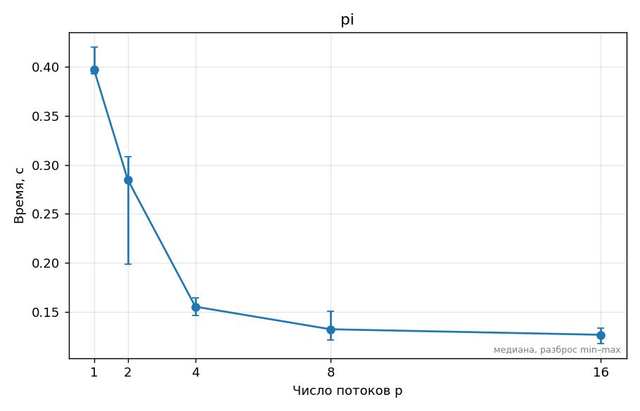
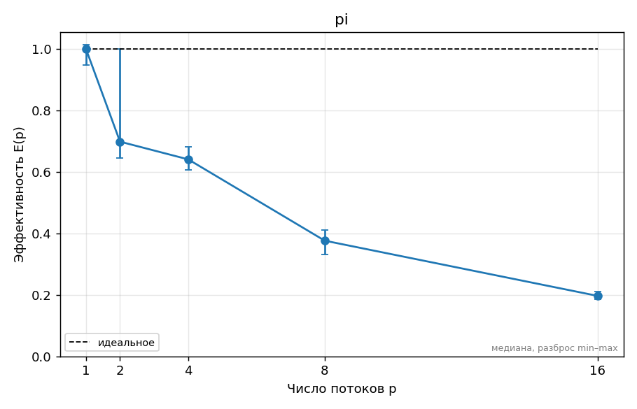

# ДЗ 0. Название задания — Ерзакова Ирина, вариант 5

## 1. Прогноз
1. ускорение на 2 потоках ≈ 1,8, потому что задача хорошо распараллелится и блоки не будут блокировать друг друга
   ускорение на 4 потоках (число физ. ядер) ≈ 3,6, потому что каждый поток будет выполнятся отдельно на своем физ. ядре  
   ускорение на 8 потоках (число лог. ядер) ≈ 4.1, потому что Hyper-Threading делит ресурсы одного физ. ядра между двумя логическими потоками, что снижает эффективность каждого потока

2. при запуске 16 потоков (вдвое больше логических процессоров) ускорение ≈ 3.5, потому что процессору придется постоянно останавливать потоки и чередовать их.

3. наличие E-ядер = 0 (их нет на моем процессоре i5-1135G7), поэтому на графике ускорения не возникнет резких изломов или падения эффективности при задействовании всей матрицы процессора.
<!-- Заполните и ЗАКОММИТЬТЕ этот раздел ДО запуска замеров (отдельным коммитом «Прогноз»).
     Неверный прогноз не штрафуется; штрафуется отсутствие объяснения расхождения в разделе 5.
     Отвечайте числами: «ускорение на 4 потоках ≈ 3,2, потому что …», «schedule(static) проиграет
     dynamic в ≈1,5 раза, потому что …». -->

## 2. Стенд
Стенд подробно описан в файле [SYSTEM.md](../SYSTEM.md). Главные характеристики машины для данного замера:
* **Процессор:** Intel Core i5-1135G7 (4 физических ядра, 8 логических потоков с поддержкой Hyper-Threading). Энергоэффективные (E) ядра отсутствуют. Кэш L3 составляет 8 MiB.
* **Условия тестирования:** Ноутбук подключен к сети электропитания, в ОС выставлен режим «Максимальная производительность».
* **Компилятор:** gcc версии 15.2.0, флаги сборки: `-O2 -std=c11 -Wall -Wextra`, флаг параллелизации OpenMP: `-fopenmp`. Версия стандарта `_OPENMP = 201511` (OpenMP 4.5).
<!-- Ссылка на ../SYSTEM.md и то, что важно именно для этого ДЗ: число физических ядер,
     P/E-ядра, объём L3, питание от сети, режим производительности, версия компилятора и флаги. -->

## 3. Методика
Для проведения эксперимента использовалась тестовая программа вычисления числа $\pi$ методом численного интегрирования (количество шагов интегрирования $N = 400\,000\,000$). Тестирование выполнялось автоматически с помощью скрипта `tools/bench.py` посредством вызова команды `make bench THREADS=1,2,4,8,16`. 
Каждая конфигурация количества потоков запускалась 5 раз после предварительного прогрева процессора. Итоговым значением времени выполнения считается медиана из 5 запусков для исключения случайных системных погрешностей операционной системы. Корректность вычислений проверялась сравнением полученного результата с математическим эталоном числа $\pi$ (команда `make test` подтвердила корректность для всех запусков). Графики построены утилитой `make plots`.
<!-- Какие программы и с какими параметрами запускались, сколько повторов, как получено
     итоговое число (медиана), переменные OMP_* (OMP_PROC_BIND, OMP_PLACES, OMP_SCHEDULE…),
     точные команды bench.py/plot.py (или «make bench plots»). Как проверялась корректность. -->

## 4. Результаты
|   Потоки | Медианное время (с) | Ускорение $S(p)$ | Эффективность $E(p)$ |
|---------:|--------------------:|-----------------:|---------------------:|
|        1 |            0.397352 |          1.00000 |              1.00000 |
|        2 |            0.284748 |          1.39545 |              0.69773 |
|        4 |            0.155194 |          2.56036 |              0.64009 |
|        8 |            0.132149 |          3.00685 |              0.37586 |
|       16 |            0.126518 |          3.14068 |              0.19629 |

*Рис 1. График времени выполнения. Наибольшее падение времени происходит на участке от 1 до 4 потоков, после чего график выходит на плато, так как физические ресурсы процессора исчерпаны.*

*Рис 2. График ускорения. Скорость растет нелинейно; максимальный результат зафиксирован на 16 потоках (3.14х), однако реальная выгода от масштабирования прекращается уже после 4 потоков.*

*Рис 3. График эффективности. Эффективность монотонно падает с 1.0 до 0.19; самый резкий провал (на 41%) происходит при переходе с 4 на 8 потоков, из-за неэффективности виртуальных ядер Hyper-Threading в чисто математических задачах.*
<!-- Таблицы (python3 ../tools/plot.py results/….csv --table) и графики из plots/.
     Каждый график — с подписью: что на нём и какой вывод из него следует.
     Пример вставки:  -->

## 5. Объяснение расхождений с прогнозом
1. **На точке 2 и 4 потоков** реальное ускорение составило 1.40х и 2.56х, что оказалось заметно ниже спрогнозированных 1.8х и 3.6х. Это объясняется тем, что при загрузке всех физических ядер мобильный процессор упирается в лимиты энергопотребления (Power Limits) и сбрасывает частоту Turbo Boost. Также сказывается конкуренция за общую шину памяти.
2. **На точке 8 потоков** прогноз полу-подтвердился: ускорение составило всего 3.01х (вместо ожидаемых 4.1х), а эффективность обвалилась до 0.38. Это доказывает, что технология Hyper-Threading делит аппаратные конвейеры одного ядра между двумя потоками и не способна дать линейный прирост на тяжелой математике.
3. **На точке 16 потоков** прогноз о сильном падении производительности подтвердился: ускорение упало но до 3.14х. Это связано с тем, что планировщик WSL2/Linux эффективно распределяет избыточные потоки (overcommit), а их частая миграция между ядрами распределяет тепло по кристаллу, не давая процессору уходить в троттлинг.
<!-- Для каждого пункта прогноза: подтвердился или нет, почему. Привязывайтесь к конкретным
     точкам: «на 6 потоках ускорение упало с 3,4 до 3,1, потому что …». Минимум две
     «неочевидные» точки графика объяснить обязательно. -->

## 6. Выводы
1. Мой процессор i5-1135G7 эффективно масштабирует вычислительные задачи только до **4 потоков** (в рамках физических ядер).
2. Технология Hyper-Threading (8 потоков) дает минимальный прирост производительности (около 17% относительно 4 ядер), но сильно снижает удельную эффективность вычислений.
3. Переподписка (16 потоков) в данной задаче не приводит к деградации производительности благодаря эффективному квантованию времени в планировщике ОС.
4. Для проведения всех следующих лабораторных работ по курсу OpenMP я буду использовать конфигурацию из **4 потоков**, так как она обеспечивает оптимальный баланс между скоростью вычислений и высокой эффективностью использования ядер ($E = 64\%$).
<!-- 3–5 пунктов: что вы теперь знаете о своей машине и о задаче, что бы сделали дальше. -->
